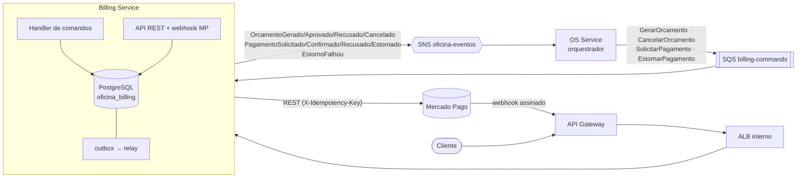

# Billing Service — Oficina Mecânica

Orçamento e pagamento das ordens de serviço (integração com o Mercado Pago). Um dos **três microsserviços** da Fase 4 do Tech Challenge SOAT
(FIAP Pós-Tech), ao lado do OS Service
([`soat15-tech-challenge-01`](https://github.com/PedrosPinho/soat15-tech-challenge-01),
orquestrador da Saga) e do Execution Service.

> **Status**: Etapa 4 do [`PHASE_4_PLAN`](https://github.com/PedrosPinho/soat15-tech-challenge-01/blob/main/docs/PHASE_4_PLAN.md) concluída —
> domínio, consumidor de comandos, outbox/inbox, integração com o Mercado Pago, webhook assinado, API, Terraform, K8s e CI.
> Pendente de validação com Docker/AWS/conta Mercado Pago: integração com PostgreSQL, `terraform apply` e o sandbox real do MP.

## Responsabilidades

- **Orçamento**: gerar a partir dos itens/preços recebidos do OS Service, enviar ao cliente (e-mail), aprovar/recusar, cancelar (compensação).
- **Pagamento**: criar a preferência de pagamento no **Mercado Pago** (Checkout Pro), receber o webhook, verificar o pagamento no MP, estornar (compensação).
- **Resumo financeiro** para o dashboard do OS Service (`GET /internal/financeiro/resumo`).

## Banco de dados

**PostgreSQL 16** — database `oficina_billing`, role `billing_service`, na mesma instância RDS do OS Service (isolamento lógico, [ADR-012](https://github.com/PedrosPinho/soat15-tech-challenge-01/blob/main/docs/architecture/adrs/ADR-012-isolamento-de-banco-por-database-e-role.md)). Dados transacionais e relacionais (orçamento ↔ itens ↔ pagamento).

Nenhum outro serviço acessa este banco diretamente — dados trafegam por
mensagens e pelas rotas `/internal/*`.

## Comunicação

- **Consome**: `GerarOrcamento`, `CancelarOrcamento`, `SolicitarPagamento`, `EstornarPagamento` (fila `billing-commands`)
- **Publica**: `OrcamentoGerado`, `OrcamentoFalhou`, `OrcamentoAprovado`, `OrcamentoRecusado`, `OrcamentoCancelado`, `PagamentoSolicitado`, `PagamentoConfirmado`, `PagamentoRecusado`, `PagamentoEstornado`, `EstornoFalhou` (tópico SNS `oficina-eventos`)
- Contratos, envelope e regras de consumo (idempotência, DLQ): [`contratos-mensagens.md`](https://github.com/PedrosPinho/soat15-tech-challenge-01/blob/main/docs/architecture/contratos-mensagens.md)
- Saga **orquestrada** pelo OS Service — justificativa em [`ADR-009`](https://github.com/PedrosPinho/soat15-tech-challenge-01/blob/main/docs/architecture/adrs/ADR-009-saga-orquestrada.md) e [`RFC-005`](https://github.com/PedrosPinho/soat15-tech-challenge-01/blob/main/docs/architecture/rfcs/RFC-005-microsservicos-e-saga.md). Este serviço não conhece o fluxo global: recebe comandos e responde com eventos.

## Ciclo e regras

- **Orçamento**: `GERADO → APROVADO | RECUSADO | CANCELADO | EXPIRADO` (`APROVADO → CANCELADO` na compensação). A **precificação é do OS Service**; aqui só se valida que o total fecha com os itens.
- **Pagamento**: `PENDENTE → CONFIRMADO | RECUSADO`, `CONFIRMADO → ESTORNADO`. Índice único parcial: no máximo um pagamento "vivo" por orçamento.
- **Mercado Pago (Checkout Pro)** — [ADR-014](https://github.com/PedrosPinho/soat15-tech-challenge-01/blob/main/docs/architecture/adrs/ADR-014-mercado-pago-checkout-pro-apos-aprovacao.md): a preferência leva `external_reference = orcamentoId`; o cartão nunca passa pelo nosso backend.
- **Webhook** `POST /api/pagamentos/webhooks/mercadopago`: valida `x-signature` (HMAC-SHA256 de `id:<data.id>;request-id:<x-request-id>;ts:<ts>;`), **nunca confia no corpo** (reconsulta `GET /v1/payments/:id`), recusa valor diferente do cobrado e é idempotente (webhook repetido ⇒ um só evento).
- **Pagamento tardio**: se o cliente paga um link já cancelado, o pagamento é registrado e a Saga o estorna.
- **Escritas no MP** (preferência, estorno) levam `X-Idempotency-Key`; chamadas ao MP ficam fora da transação do banco.
- Um cartão recusado (titular `OTHE` no sandbox) publica `PagamentoRecusado` e a Saga compensa — é assim que se demonstra a falha de pagamento.

## Endpoints

| Método | Rota | Escopo | Descrição |
|---|---|---|---|
| GET | `/api/orcamentos?ordemServicoId=` | interno / cliente dono | Orçamento da OS |
| GET | `/api/orcamentos/:id` | interno / cliente dono | Orçamento (inclui `initPoint` quando há pagamento) |
| POST | `/api/orcamentos/:id/aprovar` | interno / cliente dono | Aprova |
| POST | `/api/orcamentos/:id/recusar` | interno / cliente dono | Recusa |
| POST | `/api/orcamentos/:id/webhook` | segredo compartilhado | Aprovação externa |
| GET | `/api/pagamentos?ordemServicoId=` | interno / cliente dono | Pagamentos da OS |
| POST | `/api/pagamentos/webhooks/mercadopago` | público (HMAC `x-signature`) | Webhook do Mercado Pago |
| GET | `/internal/financeiro/resumo` | `x-internal-token` | Receita total (usado pelo OS Service) |
| POST | `/internal/pagamentos/:id/sincronizar` | `x-internal-token` | Reconciliação com o MP |

Swagger em `/api/orcamentos/docs` (JSON em `/api/orcamentos/docs.json`). Healthchecks: `GET /health/live`, `GET /health/ready`.

## Posição na solução



Sequência completa da Saga (feliz e com compensação): [`sequence-saga-feliz.md`](https://github.com/PedrosPinho/soat15-tech-challenge-01/blob/main/docs/architecture/sequence-saga-feliz.md) ·
[`sequence-saga-compensacao.md`](https://github.com/PedrosPinho/soat15-tech-challenge-01/blob/main/docs/architecture/sequence-saga-compensacao.md). Modelo de dados deste serviço:
[`data-model.md`](https://github.com/PedrosPinho/soat15-tech-challenge-01/blob/main/docs/architecture/data-model.md) (seção Billing).


## Arquitetura do serviço

```
src/
├── domain/           # Entidades, value objects, ports (repositórios, mensageria)
├── application/      # Casos de uso, handlers de comandos
├── infrastructure/   # Adapters: banco, SQS/SNS, segurança, notificações
├── presentation/     # Controllers, rotas, middlewares, validators
├── main/             # Composition root
└── shared/           # Erros de domínio, logger (pino + correlationId)
```

## Stack

Node.js 20 · TypeScript (strict) · Express 5 · PostgreSQL 16 (`pg` + `node-pg-migrate`) · SQS/SNS · pino · Jest + Supertest · New Relic · Docker · Kubernetes (EKS)

## Executando localmente

```bash
cp .env.example .env
docker compose up -d postgres localstack   # dependências
npm ci
npm run db:migrate
npm run dev                                # http://localhost:3001
```

`docker compose up --build` sobe tudo (API na porta 3003) com `PAYMENT_GATEWAY=fake`. Para o sandbox real do Mercado Pago use `PAYMENT_GATEWAY=mercadopago`, `MP_ACCESS_TOKEN` (`TEST-…`), `MP_WEBHOOK_SECRET` e uma `MP_NOTIFICATION_URL` pública (ver `.env.example`). Modos: `MESSAGING_DRIVER=memory` roda sem AWS; `MESSAGING_ENABLED=false` roda só a API.

Ambiente completo com os 3 serviços: `docker-compose.integration.yml` e `scripts/smoke-fluxo-feliz.sh` no repositório do OS Service.

Testes: `npm test` · cobertura: `npm run test:coverage` (threshold 80%) · lint: `npm run lint` · tipos: `npm run type-check`.

## Qualidade, CI/CD e cobertura

- CI em GitHub Actions (`.github/workflows/ci-cd.yml`): `Build` (tipos, lint, build), `Test` (cobertura com threshold de 80%) e `Sonar` (SonarCloud; o passo espera o quality gate). Em PR roda também `Terraform plan`; em push (`homolog`) `terraform apply` → build/push no ECR → deploy.
- Jobs de infraestrutura: `terraform-validate` (fmt + validate), `terraform-apply` (ECR e fila `billing-commands` + DLQ; `apply` só em `homolog`, `plan` em `main` — ADR-007), `docker-build-push` (ECR) e `deploy` (EKS, com Job de migration). SonarCloud entra na Etapa 8.
- `tests/integration.postgres.spec.ts` roda contra PostgreSQL real (service container no CI; localmente defina `TEST_DATABASE_URL`).
- Infra do serviço em [`terraform/`](terraform) e manifests em [`k8s/`](k8s). Requer o `apply` prévio do OS Service (dono do tópico `oficina-eventos`) e o bootstrap do banco `oficina_billing` (Etapa 5).
- Evidência de cobertura: _a preencher_ (badge SonarCloud + relatório do CI).
- `main` e `homolog` protegidas: PR obrigatório e status checks `Build`, `Test` e `Sonar` (`scripts/protect-branches.sh` no repo do OS Service aplica). `destroy.yml` (manual) remove workloads e infra do serviço.

## Cobertura e documentação da API

- **Cobertura**: 98,2 % de linhas · 93,5 % de branches · 96,6 % de funções (`npm run test:coverage`, sem os testes de integração
  que exigem Postgres/LocalStack; mínimo exigido 80 %). O CI publica o relatório e o SonarCloud aplica o quality gate
  (badge no repositório do OS Service).
- **Contratos**: `tests/contracts/` — este serviço consome os comandos reais do OS (`os-commands.json`) e produz os eventos
  que o OS consome (`billing-events.json`); ver o README do OS Service, seção Testes.
- **Swagger**: `/api/orcamentos/docs`. **Postman do fluxo completo** (3 serviços, variáveis encadeadas):
  [`oficina-fase4-fluxo-completo.postman_collection.json`](https://github.com/PedrosPinho/soat15-tech-challenge-01/blob/main/docs/postman/oficina-fase4-fluxo-completo.postman_collection.json).
- **Mercado Pago em dev**: `PAYMENT_GATEWAY=fake` (padrão do compose) + `POST /internal/dev/mercadopago/pagamentos` e
  `/internal/pagamentos/:id/sincronizar` simulam o comprador; com `mercadopago`, o sandbox real (ver `.env.example`).


## Documentação da arquitetura

Documentação geral (diagrama de componentes, Saga, ADRs, RFCs, modelo de dados) no
repositório [`soat15-tech-challenge-01`](https://github.com/PedrosPinho/soat15-tech-challenge-01/tree/main/docs/architecture).
